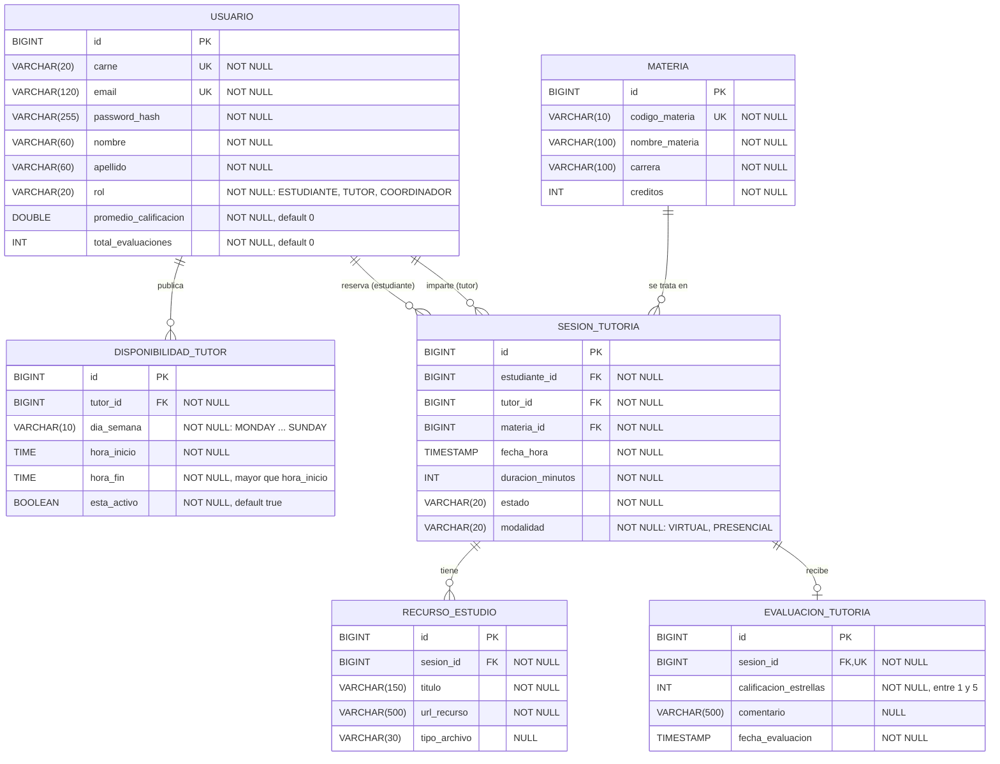

# Modelo Entidad-Relación

Base de datos H2 en modo archivo. Los enums se guardan como texto (`@Enumerated(EnumType.STRING)`).

## Relaciones

| Relación | Cardinalidad | FK |
|---|---|---|
| Usuario (tutor) – DisponibilidadTutor | 1 : N | `disponibilidad_tutor.tutor_id` |
| Usuario (estudiante) – SesionTutoria | 1 : N | `sesion_tutoria.estudiante_id` |
| Usuario (tutor) – SesionTutoria | 1 : N | `sesion_tutoria.tutor_id` |
| Materia – SesionTutoria | 1 : N | `sesion_tutoria.materia_id` |
| SesionTutoria – RecursoEstudio | 1 : N | `recurso_estudio.sesion_id` |
| SesionTutoria – EvaluacionTutoria | 1 : 0..1 | `evaluacion_tutoria.sesion_id` (única) |

Usuario y Materia quedan en relación N:M a través de `sesion_tutoria`: un estudiante puede recibir tutorías de muchas materias y una materia la reciben muchos estudiantes.

## Restricciones

- `usuario.carne`, `usuario.email` y `materia.codigo_materia` son únicos.
- `evaluacion_tutoria.sesion_id` es único: una sesión se evalúa una sola vez.
- `estado` toma los valores `REQUESTED`, `CONFIRMED`, `REJECTED`, `CANCELLED`, `IN_SESSION`, `COMPLETED`, `REVIEWED`.
- `disponibilidad_tutor.tutor_id` y `sesion_tutoria.tutor_id` deben apuntar a un usuario con rol `TUTOR`. Esto se valida en la capa de servicio, no en la base de datos.
- Los traslapes de sesiones y la regla de cancelación con 2 horas también se validan en el servicio.
